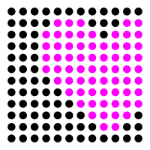

# Bonnie

A Raspberry Pi web app for displaying messages on LED matrices



Years ago, I bought four P5 RGB LED matrix panels (64 × 32 pixels each, 5 mm pixel pitch, 1/16 scan), forming a 256 × 32-pixel display approximately 128 cm wide.

They came with a custom controller board equipped with an audio input and a microphone, plus a remote control. It could display various kinds of spectrum analyzers.

A few days ago, I imagined myself as a YouTuber. I wish I had more time! There's so much I'd like to share about books, music, software... Anyway, I pictured the panels behind me in my videos, displaying scrolling text to highlight this and that.

So I bought [this RGB Matrix Bonnet from Adafruit](https://www.adafruit.com/product/3211) (hence the name Bonnie), dug out a Raspberry Pi 4, and flashed an SD card with the latest version of Raspberry Pi OS using Raspberry Pi Imager.

I loved that you can configure everything before flashing the card, including Wi-Fi and SSH authentication using a public key.

So, when I powered up the Pi, it was already connected to my Wi-Fi network. I just retrieved its IP address from my router's web interface and connected via SSH.

I started by playing around with [rpi-rgb-led-matrix](https://github.com/hzeller/rpi-rgb-led-matrix).

For future reference, here are the commands I used to clone and compile it on the Pi.

```
mkdir -p Documents/GitHub/hzeller
cd Documents/GitHub/hzeller/
git clone https://github.com/hzeller/rpi-rgb-led-matrix.git
cd rpi-rgb-led-matrix/
make -C examples-api-use
make -C utils text-scroller
```

After some experimentation, I settled on my preferred way to display static text.

```
./utils/text-scroller \
  --led-chain=4 \
  --led-cols=64 \
  --led-gpio-mapping=adafruit-hat \
  --led-rows=32 \
  -f fonts/10x20.bdf \
  -x 48 \
  -y 6 \
  -s 0 \
  -C 255,0,255 \
  "Hi! Bonnie here. ♥♪"
```

And scrolling text.

```
./utils/text-scroller \
  --led-chain=4 \
  --led-cols=64 \
  --led-gpio-mapping=adafruit-hat \
  --led-rows=32 \
  -f fonts/10x20.bdf \
  -y 6 \
  -C 255,255,255 \
  "I must not fear. Fear is the mind-killer. Fear is the little-death that brings total obliteration. I will face my fear. I will permit it to pass over me and through me. And when it has gone past I will turn the inner eye to see its path. Where the fear has gone there will be nothing. Only I will remain. — Frank Herbert, Dune"
```

Then I decided to expose the `text-scroller` utility through a simple web API, supporting just three features: custom text, color, and the option to disable scrolling.

And Bonnie is the result.

Again, for future reference, these are the commands I used to run it on the Pi.

```
cd ~
mkdir -p Documents/GitHub/fabioscagliola
cd Documents/GitHub/fabioscagliola/
git clone https://github.com/fabioscagliola/Bonnie.git
cd Bonnie
python3 -m venv .venv
.venv/bin/pip install -r requirements.txt
.venv/bin/python -m uvicorn bonnie:bonnie --host 0.0.0.0 --port 65535
```

And these are the equivalent `curl` requests for the two examples above. Static text.

```
curl 'http://192.168.1.80:65535/text-scroller' \
--header 'Content-Type: application/json' \
--data '{"text": "Hi! Bonnie here. ♥♪", "disable_scrolling": true, "color": "255,0,255"}'
```

And scrolling text.

```
curl 'http://192.168.1.80:65535/text-scroller' \
--header 'Content-Type: application/json' \
--data '{"text": "I must not fear. Fear is the mind-killer. Fear is the little-death that brings total obliteration. I will face my fear. I will permit it to pass over me and through me. And when it has gone past I will turn the inner eye to see its path. Where the fear has gone there will be nothing. Only I will remain. — Frank Herbert, Dune"}'
```

## Frontend

I eventually decided to add a simple frontend using Streamlit, making it easier to interact with Bonnie without having to send HTTP requests manually.

Again, for future reference, here's how I run it on the Pi.

```bash
cd ~/Documents/GitHub/fabioscagliola/Bonnie/frontend
python3 -m venv .venv
.venv/bin/pip install -r requirements.txt
.venv/bin/streamlit run bonnie.py
```

I can now open http://192.168.1.80:8501 from any device on my local network and tell Bonnie what to display.

